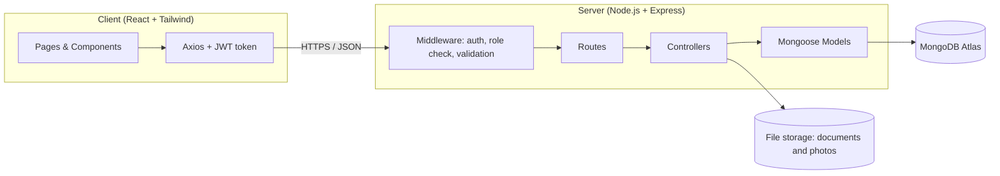
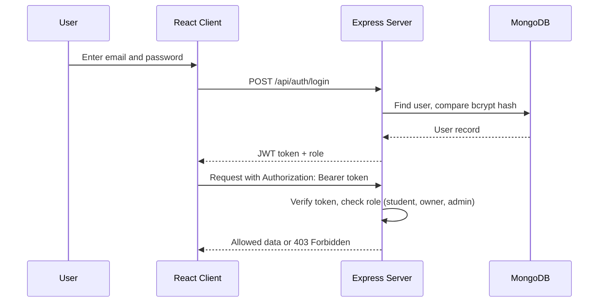
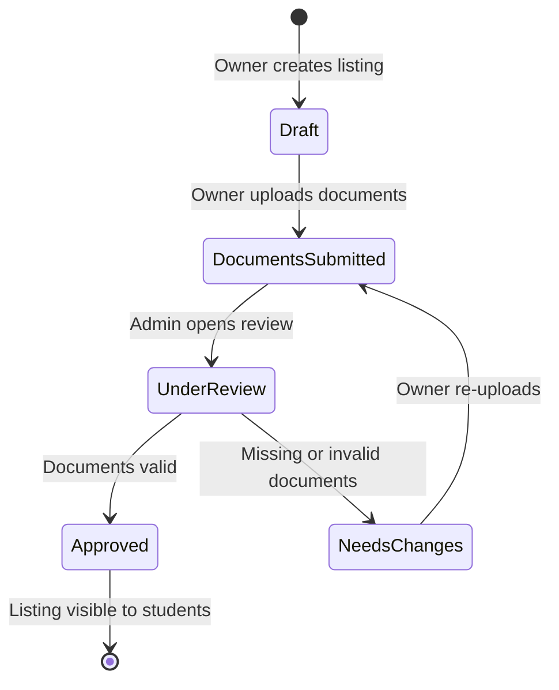
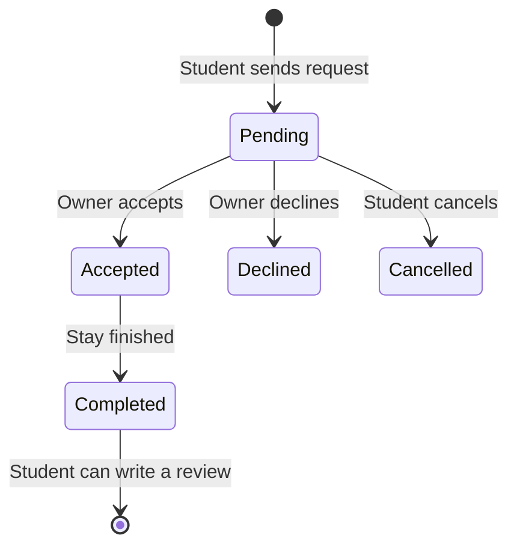

# Nest Living — Implementation Plan

**Project:** Nest Living — Verified Student Hostel Finder
**Scope:** Hostels and PGs near GCT Bhakkar
**Stack:** MERN (MongoDB, Express.js, React.js, Node.js)
**Duration:** 16 weeks
**Status:** Planning and design complete; development in progress

---

## Table of Contents

1. [Project Overview & Objectives](#1-project-overview--objectives)
2. [Proposed Technology Stack](#2-proposed-technology-stack)
3. [Project Architecture & Workflow](#3-project-architecture--workflow)
4. [Main Features & Modules](#4-main-features--modules)
5. [Development Phases & Implementation Steps](#5-development-phases--implementation-steps-16-week-timeline)
6. [Testing Plan](#6-testing-plan)
7. [Deployment Plan](#7-deployment-plan)
8. [Risks & Mitigation](#8-risks--mitigation)

---

## 1. Project Overview & Objectives

### 1.1 Overview

Nest Living is a hyper-local, web-based hostel and PG (Paying Guest) booking platform for students of GCT Bhakkar. Students currently find accommodation through word-of-mouth and unverified social media groups, parents have no way to check how safe a hostel is, and hostel owners manage bookings on paper registers.

Nest Living solves this with three ideas:

- **An admin-verification layer.** Every hostel must submit documents and pass an admin review before it is shown to students.
- **A parent safety view.** Parents can check verified status, warden contact details and curfew rules before their child moves in.
- **A digital dashboard for owners.** Owners manage rooms, availability and booking requests in one place instead of on paper.

### 1.2 Objectives

| # | Objective | How it is measured |
|---|-----------|--------------------|
| 1 | Give students one place to search, filter and compare hostels | Search by rent, room type, gender and amenities returns results in under 2 seconds |
| 2 | Show only verified hostels | A hostel appears in search only after the admin approves it |
| 3 | Give parents a read-only safety view | Public page shows verified status, warden contact and rules, with no login required |
| 4 | Digitise owner operations | Owners can add rooms, update availability and accept or decline requests online |
| 5 | Provide a complaint and review system | Students can raise complaints and rate stays; admin can escalate unresolved complaints |

### 1.3 Scope

**In scope**

- Student, Owner, Admin and Parent (read-only) modules
- Hostel and room listing, search and filters
- Booking request workflow (request, accept or decline)
- Admin document verification workflow
- Reviews, complaints and basic roommate matching
- Responsive web application (desktop and mobile browsers)

**Out of scope (possible future work)**

- Online payments (rent is paid to the owner directly at move-in)
- Machine-learning based roommate matching (a simple rule-based match is used)
- Native mobile apps
- Coverage beyond the GCT Bhakkar area

---

## 2. Proposed Technology Stack

| Layer | Technology | Why it was chosen |
|-------|------------|-------------------|
| Database | **MongoDB** (Atlas free tier) | Flexible JSON-like documents suit hostel listings with varying amenities; free cloud hosting |
| Backend framework | **Express.js** | Lightweight, widely documented, simple REST API routing |
| Runtime | **Node.js** | One language (JavaScript) across frontend and backend |
| Frontend | **React.js** | Component-based UI; fast single page application (SPA) |
| Styling | **Tailwind CSS** | Rapid, mobile-responsive UI without writing custom CSS files |
| HTTP client | **Axios** | Clean API calls and request interceptors for attaching tokens |
| ODM | **Mongoose** | Schemas, validation and relationships on top of MongoDB |
| Authentication | **JWT + bcrypt** | Stateless role-based authentication; passwords are hashed, never stored in plain text |
| File uploads | **Multer** (with Cloudinary or local storage) | Owner verification documents and hostel photos |
| API testing | **Postman** | Manual and collection-based API testing |
| Version control | **Git + GitHub** | Source control, collaboration and deployment trigger |
| Design | **Figma** | UI mockups for all screens, desktop and mobile |

---

## 3. Project Architecture & Workflow

### 3.1 High-level architecture

Nest Living follows a standard **client-server architecture** with a REST API in the middle.



1. **Client (React):** The user interface. Sends HTTP requests with Axios and attaches the JWT token to protected requests.
2. **Server (Express/Node):** Receives requests, checks the token and the user's role, validates input and runs the business logic.
3. **Database (MongoDB):** Stores users, hostels, rooms, bookings, reviews, complaints and roommate preferences. The server talks to it through Mongoose.

### 3.2 Request flow example

A student searches for hostels:

> Student clicks **Search Hostels** → React sends `GET /api/hostels?maxRent=10000&gender=boys` → Express runs the query on MongoDB (only `verified` hostels) → MongoDB returns matching documents → Express sends a JSON response → React renders the hostel cards.

### 3.3 Authentication and role-based access



### 3.4 Core workflows

**Hostel verification workflow**



**Booking workflow**



### 3.5 Database design

The database is built around seven main collections.

| Collection | Purpose | Key fields |
|-----------|---------|-----------|
| `users` | All accounts | name, email, passwordHash, role (`student` / `owner` / `admin`), phone, institute |
| `hostels` | Hostel listings | owner (ref), name, type (boys/girls), address, distanceKm, amenities[], rules, wardenName, wardenPhone, verificationStatus, documents[], photos[] |
| `rooms` | Room types per hostel | hostel (ref), type, beds, rentPerMonth, availableBeds |
| `bookings` | Booking requests | student (ref), room (ref), moveInDate, durationMonths, status, message |
| `reviews` | Ratings after a stay | student (ref), hostel (ref), rating, categoryRatings, comment |
| `complaints` | Issues raised by students | student (ref), hostel (ref), category, description, status, adminNote |
| `roommatePreferences` | Matching preferences | student (ref), budgetMin, budgetMax, sleepSchedule, studyHabits, smoking, roomType |

Relationships: one owner has many hostels; one hostel has many rooms; one room has many bookings; one student has many bookings, reviews and complaints.

### 3.6 Project folder structure

```
nest-living/
├── README.md
├── docs/
│   └── implementation-plan.md
├── server/
│   ├── config/          # database connection, environment config
│   ├── models/          # Mongoose schemas (User, Hostel, Room, ...)
│   ├── controllers/     # business logic
│   ├── routes/          # Express routes
│   ├── middleware/      # auth, role check, upload, error handler
│   ├── server.js
│   └── .env             # not committed
└── client/
    ├── public/
    └── src/
        ├── components/  # reusable UI: HostelCard, Navbar, Forms
        ├── pages/       # Landing, Search, HostelDetail, Dashboards
        ├── services/    # Axios API calls
        ├── context/     # auth state
        └── App.js       # routes
```

---

## 4. Main Features & Modules

### 4.1 Auth Module

- Register as student or owner; login for all roles
- Passwords hashed with bcrypt; JWT token issued on login
- Role-based route protection (student, owner, admin)

### 4.2 Student Module

- Search hostels and filter by rent, room type, gender and amenities
- View hostel details: photos, rooms, rules, reviews
- Send a booking request and track it under **My Bookings**
- Roommate matching based on budget, sleep schedule and study habits
- Write reviews after a completed stay; file and track complaints

### 4.3 Owner Module

- Create hostel listings and add room types with rent and beds
- Upload verification documents (CNIC, ownership or rent deed, utility bill, police letter)
- Manage room availability
- Dashboard: occupancy, pending requests; accept or decline bookings
- View reviews and respond to complaints

### 4.4 Admin Module

- Verification queue: review documents and approve, reject or request changes
- Complaint management: review owner replies, escalate or mark resolved
- User management: view, suspend or restore accounts
- Basic platform statistics

### 4.5 Parent Module

- Public, read-only hostel safety page (no login required)
- Shows verified status, warden name and contact, curfew and house rules, and ratings
- Shareable link that a student can send to their parents

### 4.6 Main API endpoints

| Module | Method and path | Description |
|--------|-----------------|-------------|
| Auth | `POST /api/auth/register` | Create an account |
| Auth | `POST /api/auth/login` | Log in and receive a JWT |
| Auth | `GET /api/auth/me` | Current user profile |
| Hostels | `GET /api/hostels` | Search with filters (verified only) |
| Hostels | `GET /api/hostels/:id` | Hostel details |
| Hostels | `POST /api/hostels` | Create listing (owner) |
| Hostels | `PUT /api/hostels/:id` | Update listing (owner) |
| Rooms | `POST /api/hostels/:id/rooms` | Add a room type (owner) |
| Rooms | `PUT /api/rooms/:id` | Update rent or availability (owner) |
| Bookings | `POST /api/bookings` | Send a booking request (student) |
| Bookings | `GET /api/bookings/my` | Student's bookings |
| Bookings | `GET /api/bookings/owner` | Requests for the owner's hostels |
| Bookings | `PATCH /api/bookings/:id/status` | Accept, decline or cancel |
| Admin | `GET /api/admin/hostels/pending` | Verification queue |
| Admin | `PATCH /api/admin/hostels/:id/verify` | Approve, reject or request changes |
| Reviews | `POST /api/hostels/:id/reviews` | Add a review (completed stay only) |
| Complaints | `POST /api/complaints` | File a complaint |
| Complaints | `PATCH /api/admin/complaints/:id` | Escalate or resolve (admin) |
| Roommates | `PUT /api/roommates/preferences` | Save preferences |
| Roommates | `GET /api/roommates/matches` | Suggested matches |
| Parent | `GET /api/parent/hostels/:id` | Public safety information |

### 4.7 UI design

All screens have been designed in Figma using the Nest Living brand colour `#028090` (teal), covering the Landing page, Login and Sign up, Search, Hostel Detail, Booking, My Bookings, Roommate Matching, Reviews and Complaints, the Owner Dashboard and Add Listing form, the Admin screens (Verification, Complaints, Users) and mobile versions. These designs are the reference for the React components in Phase 3.

---

## 5. Development Phases & Implementation Steps (16-Week Timeline)

### Phase 1: Planning & Design (Weeks 1–2)

**Steps**
- Finalise requirements and the list of features for each role
- Create the ERD (database schema) and data flow diagrams
- Design UI wireframes and high-fidelity mockups for all dashboards

**Deliverables:** requirements document, ERD, DFD, Figma designs

### Phase 2: Backend Development (Weeks 3–6)

**Steps**
- Set up the Express server and connect to MongoDB Atlas
- Create Mongoose models for the seven collections
- Build authentication: register, login, JWT middleware and role checks
- Develop REST APIs for Hostels, Rooms and Bookings
- Add file upload for verification documents and photos
- Build the admin verification, review and complaint endpoints
- Test every API with Postman

**Deliverables:** working REST API and a Postman collection

### Phase 3: Frontend Development (Weeks 7–12)

**Steps**
- Set up React with Tailwind CSS and configure routing
- Build shared components (navbar, hostel card, forms, status badges)
- Build the student pages: search, hostel detail, booking, my bookings
- Build the owner dashboard and the add-listing form
- Build the admin verification and complaint screens
- Add roommate matching, reviews and the parent safety page
- Integrate everything with the backend using Axios
- Make all pages responsive for mobile

**Deliverables:** complete web application connected to the backend

### Phase 4: Testing & Bug Fixing (Weeks 13–14)

**Steps**
- End-to-end testing of each user journey (for example: can a student actually book a room?)
- Fix logic bugs and UI responsiveness issues
- Test with a few classmates and collect feedback
- Final security checks (see Section 6)

**Deliverables:** test report and a bug-free release candidate

### Phase 5: Deployment & Documentation (Weeks 15–16)

**Steps**
- Deploy the frontend to Vercel and the backend to Render
- Host the database on MongoDB Atlas (free tier)
- Write the final project report and update the README
- Prepare the demo and presentation

**Deliverables:** live application URL, final report, presentation

### Timeline summary

| Weeks | Phase | Main output |
|-------|-------|-------------|
| 1–2 | Planning & Design | ERD, DFD, Figma designs |
| 3–6 | Backend | REST API tested in Postman |
| 7–12 | Frontend | Complete React application |
| 13–14 | Testing & Bug Fixing | Test report, fixes |
| 15–16 | Deployment & Documentation | Live app, final report |

---

## 6. Testing Plan

### 6.1 Testing levels

| Level | What is tested | Tool |
|-------|----------------|------|
| API testing | Every backend route returns the correct status code and data format, including error cases | Postman |
| Manual functional testing | Complete user journeys as Student, Owner and Admin | Browser |
| Role and security testing | A student cannot open owner or admin routes; passwords are hashed; invalid tokens are rejected | Postman + browser |
| Responsive testing | Pages work on desktop and mobile screen sizes | Browser dev tools |
| Usability testing | Classmates try the main journeys and give feedback | Observation |

### 6.2 Sample test cases

| ID | Scenario | Expected result |
|----|----------|-----------------|
| TC-01 | Register with valid details | Account created; password stored as a hash |
| TC-02 | Login with a wrong password | Rejected with 401 |
| TC-03 | Student calls an admin route | Rejected with 403 |
| TC-04 | Search with a rent filter | Only verified hostels within the budget are returned |
| TC-05 | Owner submits a hostel for verification | Status becomes "documents submitted"; hostel not yet visible to students |
| TC-06 | Admin approves a hostel | Hostel appears in student search |
| TC-07 | Student sends a booking request | Booking created with status "pending"; owner sees it on the dashboard |
| TC-08 | Owner accepts a request | Status becomes "accepted"; available beds reduce by one |
| TC-09 | Student reviews a hostel without a completed stay | Rejected |
| TC-10 | Student files a complaint | Complaint visible to the owner and the admin |

### 6.3 Security checklist

- Passwords hashed with bcrypt, never stored or logged in plain text
- JWT secret and database URI kept in environment variables, never committed to GitHub
- Input validation on all routes to prevent invalid or malicious data
- Role checks on every protected route
- File upload limited by type and size

---

## 7. Deployment Plan

| Part | Platform | Notes |
|------|----------|-------|
| Frontend (React) | **Vercel** (free tier) | Automatic deployment from the GitHub repository on every push to `main` |
| Backend (Node/Express) | **Render** (free tier) | Environment variables set in the Render dashboard |
| Database | **MongoDB Atlas** (free tier) | Cloud-hosted; network access restricted to the backend |
| File storage | Cloudinary or backend storage | For documents and photos |

### Deployment steps

1. Push the latest code to the `main` branch on GitHub.
2. Create a MongoDB Atlas cluster, add a database user and copy the connection string.
3. Deploy the backend on Render: connect the repository, set the root directory to `server`, add `MONGO_URI`, `JWT_SECRET` and `CLIENT_URL`.
4. Deploy the frontend on Vercel: connect the repository, set the root directory to `client`, add `REACT_APP_API_URL` (the Render backend URL).
5. Enable CORS on the backend for the Vercel domain.
6. Run the full journey (register, verify, book) on the live site.

### Environment variables

| Variable | Used by | Purpose |
|----------|---------|---------|
| `MONGO_URI` | Server | MongoDB connection string |
| `JWT_SECRET` | Server | Signing key for tokens |
| `PORT` | Server | Server port |
| `CLIENT_URL` | Server | Allowed frontend origin (CORS) |
| `REACT_APP_API_URL` | Client | Base URL of the backend API |

---

## 8. Risks & Mitigation

| Risk | Impact | Mitigation |
|------|--------|------------|
| Free hosting sleeps after inactivity (Render) | Slow first load during the demo | Open the site a few minutes before the demo |
| Not enough time for every feature | Incomplete project | Build core features first (auth, listings, booking, verification); reviews, complaints and roommate matching are secondary |
| Unverified or fake listings | Loss of trust | Mandatory admin document review before a listing is visible |
| Data loss or leaked secrets | Security problem | Keep `.env` out of Git; use Atlas backups |
| Late integration bugs | Delays | Integrate the frontend with the backend page by page, not all at the end |